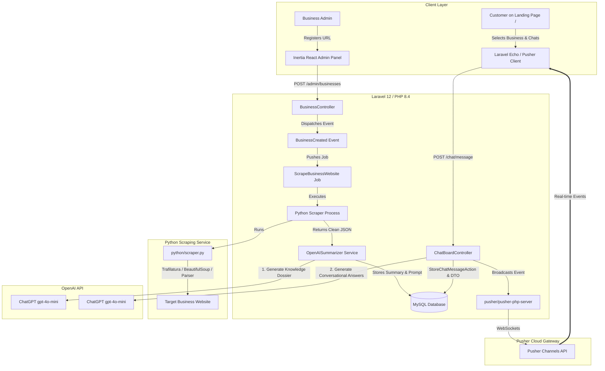
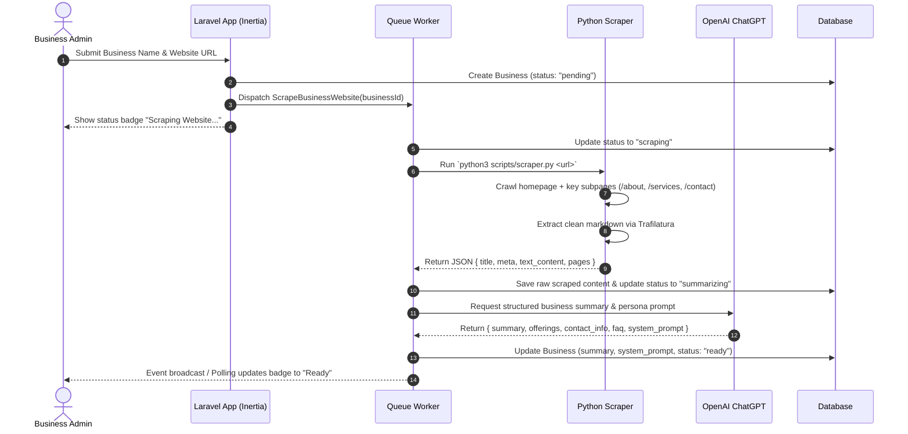
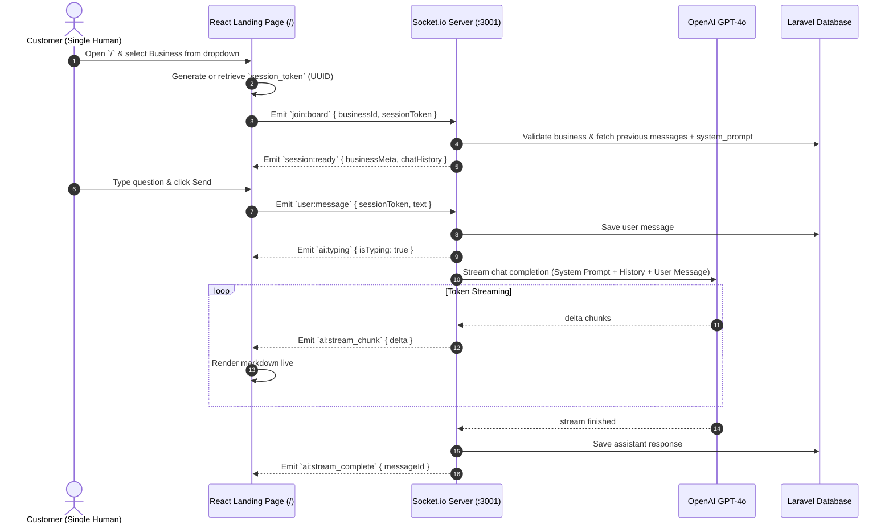

# AI Chat Board — Enterprise Architecture Blueprint & Implementation Guide

An end-to-end real-time AI chat board platform where businesses register their websites, an automated pipeline scrapes and summarizes their business knowledge with ChatGPT, and customers interact with a dedicated, context-aware AI board in real-time powered by Laravel and **Pusher** (`pusher/pusher-php-server` + Laravel Echo).

---

## 1. Executive Summary & Vision

### 1.1 The Product
- **Business Admin Portal:** An authenticated management space where business owners submit their company name and public website URL.
- **Automated Ingestion Pipeline:** An event-driven crawler executed via Python extracts the site's core content, strips boilerplate/navigation, and prompts OpenAI's ChatGPT model to synthesize a structured business knowledge profile.
- **Public Chat Hub (`/`):** A customer-facing landing page featuring a searchable business selector dropdown. Upon selecting a business, a single-human real-time chat board activates.
- **Real-Time Broadcasting Engine:** Uses **Pusher** (`pusher/pusher-php-server`) and **Laravel Echo** to provide instant real-time event broadcasting, live typing indicators, and session-isolated chat boards directly through Laravel without needing a separate Node socket daemon.

---

## 2. High-Level System Architecture



---

## 3. Core Workflows & Sequence Diagrams

### 3.1 Business Onboarding & AI Knowledge Extraction Flow



---

### 3.2 Real-time Customer Interaction Flow (Socket.io)



---

## 4. Database Schema Design

### 4.1 `businesses` Table
Stores registered businesses, scraping metadata, and AI knowledge base.

| Column | Type | Attributes | Description |
|---|---|---|---|
| `id` | `BIGINT UNSIGNED` | Primary Key, Auto Increment | Unique ID |
| `user_id` | `BIGINT UNSIGNED` | Foreign Key -> `users.id`, Nullable | Owner/admin who registered the business |
| `name` | `VARCHAR(255)` | Not Null | Business name |
| `slug` | `VARCHAR(255)` | Unique, Indexed | URL-friendly identifier |
| `website_url` | `VARCHAR(500)` | Not Null | Target public URL |
| `status` | `ENUM` | Indexed, Default: `'pending'` | `'pending'`, `'scraping'`, `'summarizing'`, `'ready'`, `'failed'` |
| `status_message` | `TEXT` | Nullable | Logs / error reason if scraping failed |
| `summary` | `LONGTEXT` | Nullable | Extracted structured business dossier |
| `system_prompt` | `LONGTEXT` | Nullable | Customized instruction prompt for ChatGPT |
| `meta` | `JSON` | Nullable | Parsed metadata (favicon, logo, title, scraped pages) |
| `created_at` | `TIMESTAMP` | Nullable | Timestamp |
| `updated_at` | `TIMESTAMP` | Nullable | Timestamp |

### 4.2 `business_scraped_data` Table
Stores raw scraped texts and page snapshots for auditability and re-indexing.

| Column | Type | Attributes | Description |
|---|---|---|---|
| `id` | `BIGINT UNSIGNED` | Primary Key, Auto Increment | Unique ID |
| `business_id` | `BIGINT UNSIGNED` | Foreign Key -> `businesses.id`, Cascade | Associated business |
| `url` | `VARCHAR(500)` | Not Null | Exact page URL scraped |
| `page_title` | `VARCHAR(255)` | Nullable | `<title>` tag |
| `clean_text` | `LONGTEXT` | Not Null | Boilerplate-free extracted markdown |
| `scraped_at` | `TIMESTAMP` | Default: `now()` | Timestamp |

### 4.3 `chat_sessions` Table
Tracks single-human visitor sessions per business board.

| Column | Type | Attributes | Description |
|---|---|---|---|
| `id` | `BIGINT UNSIGNED` | Primary Key, Auto Increment | Unique ID |
| `business_id` | `BIGINT UNSIGNED` | Foreign Key -> `businesses.id`, Cascade | Associated business |
| `session_token` | `VARCHAR(64)` | Unique, Indexed | UUID stored in client local storage / cookie |
| `visitor_ip` | `VARCHAR(45)` | Nullable | Rate limiting & audit |
| `user_agent` | `TEXT` | Nullable | Client device info |
| `status` | `ENUM` | Default: `'active'` | `'active'`, `'closed'` |
| `created_at` | `TIMESTAMP` | Nullable | Timestamp |
| `updated_at` | `TIMESTAMP` | Nullable | Timestamp |

### 4.4 `chat_messages` Table
Maintains conversational history for context window feeding.

| Column | Type | Attributes | Description |
|---|---|---|---|
| `id` | `BIGINT UNSIGNED` | Primary Key, Auto Increment | Unique ID |
| `chat_session_id` | `BIGINT UNSIGNED` | Foreign Key -> `chat_sessions.id`, Cascade | Associated session |
| `role` | `ENUM` | Not Null | `'user'`, `'assistant'`, `'system'` |
| `content` | `LONGTEXT` | Not Null | Message markdown content |
| `tokens_used` | `INT UNSIGNED` | Nullable | Token usage metric |
| `created_at` | `TIMESTAMP` | Nullable | Timestamp |

---

## 5. Component Deep Dive

### 5.1 Component 1: Authenticated Admin Panel
- **Route:** `/admin/businesses` (or integrated into `/dashboard`).
- **Access Control:** Protected by Fortify auth middleware (`auth`, `verified`).
- **Features:**
  - **Quick Register Form:** Accepts `Business Name` and `Website URL`.
  - **Input Sanitization & SSRF Protection:** Validates that URLs are public schemes (`http`/`https`) and denies private network ranges (`127.0.0.1`, `10.0.0.0/8`, `192.168.0.0/16`, AWS metadata `169.254.169.254`).
  - **Pipeline Status Tracker:** Real-time badge showing status (`Pending` -> `Scraping Website` -> `Synthesizing Knowledge` -> `Ready` or `Failed`).
  - **Knowledge Inspector:** Modal to preview the AI summary, view scraped pages, and inspect the generated system prompt.
  - **Action Controls:** "Re-scrape Now" and "Delete Business" capabilities.

### 5.2 Component 2: Python Web Scraping Engine
- **File Location:** `python/scraper.py`
- **Dependencies:** `trafilatura`, `beautifulsoup4`, `urllib3`, `certifi`.
- **Extraction Logic:**
  1. Validates and normalizes target domain.
  2. Fetches root page and discovers high-priority sublinks (matches `/about`, `/services`, `/products`, `/contact`, `/pricing`, `/faq`).
  3. Uses `trafilatura.extract()` to eliminate navigation bars, cookie consent popups, footers, and advertisements, isolating primary content into clean Markdown.
  4. Returns structured JSON to stdout:
     ```json
     {
       "status": "success",
       "business_name": "Acme Corp",
       "root_url": "https://example.com",
       "pages_crawled": 3,
       "combined_text": "### About Acme Corp\nWe build...",
       "meta": {
         "title": "Acme Corp - Cloud Solutions",
         "favicon": "https://example.com/favicon.ico"
       }
     }
     ```

### 5.3 Component 3: AI Knowledge Synthesis (ChatGPT)
- **Service:** `App\Services\OpenAISummarizer.php`
- **Step 1 — Extraction:** Feeds scraped text to `gpt-4o-mini` with a structured system prompt:
  > *"Analyze this scraped website content. Extract and structure: (1) Core Value Proposition, (2) List of Products/Services, (3) Pricing or Engagement Model, (4) Contact Channels & Operating Hours, (5) Frequently Asked Questions."*
- **Step 2 — Persona System Prompt Generation:**
  Compiles the extracted knowledge into an immutable dynamic system prompt:
  ```text
  You are the official AI representative for [Business Name].
  Your goal is to assist visitors clearly, accurately, and politely.
  
  CORE BUSINESS KNOWLEDGE:
  ---
  {Extracted Knowledge Dossier}
  ---
  
  RULES:
  1. Base your answers solely on the provided business knowledge.
  2. If the user asks about something not in the knowledge base, politely state that you do not have that specific information and provide the official contact channels.
  3. Keep responses concise, friendly, and formatted in clean markdown.
  ```

### 5.4 Component 4: Real-Time Socket.io Chat Gateway
- **Stack:** Node.js standalone daemon (`socket-server/index.mjs`) on port `3001` (managed alongside Laravel via `package.json` concurrent scripts).
- **Why Socket.io for Single Human Interaction?**
  - Instant bidirectional handshake.
  - Ultra-smooth token streaming directly to the client without long-polling overhead.
  - Granular typing indicators (`ai is typing...`).
  - Rooms partitioned by `business:{id}:session:{token}` so each human has an isolated private sandbox.
- **Socket Events:**
  - `join:board` `(data: { businessId, sessionToken })`: Client joins room; server returns initial state and recent history.
  - `user:message` `(data: { text })`: Client sends question; server streams tokens via OpenAI SDK with `stream: true`.
  - `ai:stream_chunk` `(data: { chunk })`: Server pushes incremental token to client.
  - `ai:stream_complete` `(data: { fullMessage })`: Signals stream completion and persists to DB.

### 5.5 Component 5: Public Landing Page & Interactive AI Board (`/`)
- **Location:** `resources/js/pages/welcome.tsx` (or dedicated `chat-board.tsx`).
- **UI Elements:**
  - **Top Navigation:** Platform branding + "Register Your Business" button (links to admin).
  - **Business Selector Dropdown:** Searchable selector with business logos, names, and verification badges.
  - **Active AI Board Container:**
    - Header: Business avatar, active status indicator, quick reset button.
    - Message Stream: Conversation history, markdown formatting (links, bullet points, code blocks), timestamps.
    - Suggested Starter Prompts: Clickable chips (e.g. *"What services do you offer?"*, *"How can I contact support?"*).
    - Chat Input Bar: Auto-expanding textarea, send button, keyboard shortcuts (`Enter` to send, `Shift+Enter` for newline).

---

## 6. Directory Structure & File Manifest

```
chat_board/
├── app/
│   ├── Actions/
│   │   └── Business/
│   │       ├── CreateBusinessAction.php
│   │       └── UpdateBusinessKnowledgeAction.php
│   ├── Events/
│   │   └── BusinessCreated.php
│   ├── Http/
│   │   ├── Controllers/
│   │   │   ├── Admin/
│   │   │   │   └── BusinessController.php
│   │   │   └── ChatBoardController.php
│   │   └── Requests/
│   │       └── StoreBusinessRequest.php
│   ├── Jobs/
│   │   └── ScrapeBusinessWebsiteJob.php
│   ├── Models/
│   │   ├── Business.php
│   │   ├── BusinessScrapedData.php
│   │   ├── ChatMessage.php
│   │   └── ChatSession.php
│   └── Services/
│       ├── OpenAISummarizer.php
│       └── WebScraperService.php
├── config/
│   └── chatboard.php
├── database/
│   ├── migrations/
│   │   ├── xxxx_create_businesses_table.php
│   │   ├── xxxx_create_business_scraped_data_table.php
│   │   ├── xxxx_create_chat_sessions_table.php
│   │   └── xxxx_create_chat_messages_table.php
│   └── seeders/
│       └── DemoBusinessSeeder.php
├── python/
│   ├── requirements.txt
│   └── scraper.py
├── resources/
│   └── js/
│       ├── components/
│       │   └── chat/
│       │       ├── chat-board.tsx
│       │       ├── chat-message-bubble.tsx
│       │       ├── chat-input.tsx
│       │       └── business-selector.tsx
│       ├── hooks/
│       │   └── use-socket-chat.ts
│       └── pages/
│           ├── admin/
│           │   ├── businesses/
│           │   │   ├── index.tsx
│           │   │   └── show.tsx
│           └── welcome.tsx
├── socket-server/
│   ├── package.json
│   └── index.mjs
└── tests/
    └── Feature/
        ├── BusinessRegistrationTest.php
        └── ChatSessionTest.php
```

---

## 7. Phased Implementation Roadmap

### Phase 1: Database & Core Models
- [ ] Create migrations for `businesses`, `business_scraped_data`, `chat_sessions`, and `chat_messages`.
- [ ] Implement Eloquent models with typed relationships, casts, and scopes.
- [ ] Seed dummy business records for initial UI preview.

### Phase 2: Python Scraping Worker
- [ ] Set up `python/` directory with `requirements.txt` (`trafilatura`, `beautifulsoup4`, `httpx`).
- [ ] Implement `python/scraper.py` with multi-page crawling, content cleaning, and JSON output.
- [ ] Create `App\Services\WebScraperService` to execute the Python script using Symfony `Process`.
- [ ] Add unit tests verifying parsing of sample HTML pages.

### Phase 3: AI Summarization & Knowledge Synthesis
- [ ] Integrate OpenAI API client via `openai-php/client` or Laravel `Http`.
- [ ] Implement `App\Services\OpenAISummarizer` to extract structured business summaries.
- [ ] Implement queue job `ScrapeBusinessWebsiteJob` handling end-to-end extraction and status updates.

### Phase 4: Authenticated Admin Panel
- [ ] Create `Admin\BusinessController` with index, store, show, and destroy actions.
- [ ] Build Inertia React admin views with form validation, URL validation, and live progress badges.
- [ ] Add ability to view scraped raw data and manually trigger re-scraping.

### Phase 5: Real-Time Socket.io Server
- [ ] Initialize `socket-server/` with Node.js, `socket.io`, `dotenv`, and `@openai/api`.
- [ ] Implement event listeners: `join:board`, `user:message`, and token streaming loop.
- [ ] Wire up database persistence (via direct DB query or internal Laravel signed API endpoint).
- [ ] Update root `package.json` to launch the socket server concurrently during `npm run dev`.

### Phase 6: Landing Page & Chat Board UI
- [ ] Redesign `/` (`welcome.tsx`) into a clean, modern showcase with a business selector dropdown.
- [ ] Build `useSocketChat` React hook managing connection state, message streaming, and auto-reconnect.
- [ ] Create chat board components with message bubbles, markdown styling, animated typing dots, and auto-scroll.
- [ ] Test single-human visitor isolation using persistent UUID session tokens.

### Phase 7: Testing, Hardening & Security
- [ ] Add Pest feature tests for business creation, duplicate prevention, and queue job triggers.
- [ ] Implement SSRF guards on URL submission (disallow loopback & private subnets).
- [ ] Implement IP-based rate limiting on the chat board to prevent OpenAI quota exhaustion.
- [ ] Run Laravel Pint (`vendor/bin/pint --format agent`) and TypeScript checks (`npm run check`).

---

## 8. Environment & Configuration Guide

Create and configure the following variables in your `.env` file:

```dotenv
# OpenAI Configuration
OPENAI_API_KEY=sk-proj-xxxxxxxxxxxxxxxxxxxxxxxx
OPENAI_CHAT_MODEL=gpt-4o-mini
OPENAI_STREAMING_MODEL=gpt-4o

# Python Environment
PYTHON_BIN_PATH=/usr/bin/python3

# Socket.io Real-Time Gateway
VITE_SOCKET_IO_URL=http://localhost:3001
SOCKET_IO_PORT=3001
```

---

## 9. Verification & Acceptance Criteria

| Feature | Acceptance Criteria |
|---|---|
| **Business Registration** | Admin can submit a URL; backend validates domain and dispatches scraping job asynchronously. |
| **Scraping Pipeline** | Python extracts clean page text without ads/navbars and outputs valid JSON. |
| **AI Knowledge Dossier** | ChatGPT summarizes the site into a structured persona prompt and marks the business `ready`. |
| **Public Business Selector** | Landing page dropdown lists all `ready` businesses; switching businesses loads the appropriate board. |
| **Real-time Chat Streaming** | Messages stream token-by-token via Socket.io with typing indicators and auto-scroll. |
| **Single-Human Isolation** | Session token ensures each customer has an isolated, private conversation history. |
